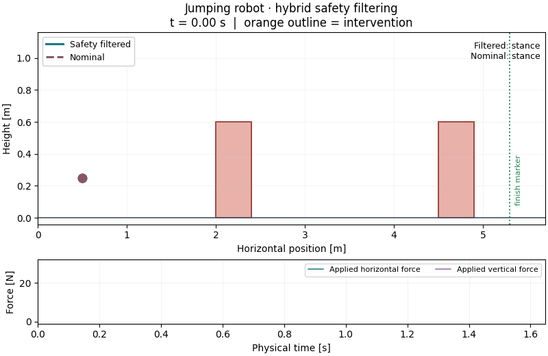
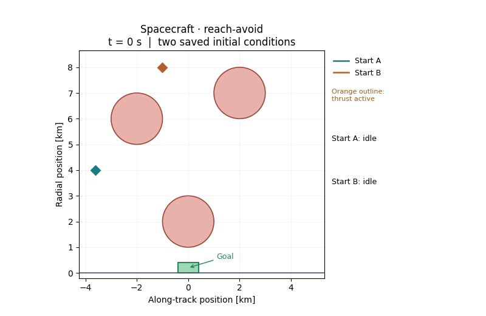

# Hybrid reachability with JAX

Compute which states of a hybrid system can reach a goal, avoid failure, or do
both. A hybrid system combines continuous motion with discrete mode changes, below we show examples of such systems with
a jumping robot that switches between stance and flight, and a spacecraft that switches
between idle, thrust and cooldown.

This Python package solves Hamilton–Jacobi reachability problems on CPU or GPU
using `hj_reachability` and JAX. It includes feedback controllers, an avoid-only
hybrid least-restrictive safety filter, and examples from the asociated RSS and IJRR
hybrid reachability papers which dig deeper into the theory behind this method.

| Jumping robot · safety filtering | Spacecraft · reach-avoid |
|:---:|:---:|
|  |  |

The jumper's filter intervenes to clear the pillars; the dashed nominal trajectory
collides. The spacecraft uses goal-seeking reach-avoid feedback from two starts.

| What would you like to do? | Start here |
|---|---|
| Understand the method and the results | [IJRR paper](https://doi.org/10.1177/02783649261477777) |
| Run a small example and learn the API | [Falling-piece tutorial](tutorials/README.md) |
| Run the paper examples | [Paper experiments and reproduction status](examples/papers/README.md) |
| Define your own system | [Tutorial model walkthrough](tutorials/README.md#2-code-the-continuous-dynamics), then [API reference](docs/API.md) |

## Install and run your first example

Use Python 3.10 or newer. From the repository root, create an environment and
install the package with its plotting and test dependencies:

```bash
python3 -m venv .venv
source .venv/bin/activate
python -m pip install -e '.[examples,test]'
JAX_PLATFORMS=cpu JAX_ENABLE_X64=true python tutorials/falling_piece.py
```

This runs the tutorial two-dimensional falling-piece model with three objectives:
reach a target, avoid obstacles, and reach the target while avoiding obstacles.
It solves each problem, simulates several initial conditions, and writes a BRT
plot and a policy GIF. Avoid also compares an arbitrary nominal policy with its
safety-filtered version. A GPU is optional.

See [setup and troubleshooting](docs/SETUP.md) for GPU use, environment checks
and common errors.

## Citation

If you use this code, please cite:

```bibtex
@article{borquez2026hybridreach,
author = {Javier Borquez and Shuang Peng and Somil Bansal},
title ={Hamilton-Jacobi reachability for hybrid systems: Unified goal-driven control with safety guarantees},
journal = {The International Journal of Robotics Research},
volume = {0},
number = {0},
year = {2026},
doi = {10.1177/02783649261477777}}

@INPROCEEDINGS{Borquez-RSS-24,
    AUTHOR    = {Javier Borquez AND Shuang Peng AND Yiyu Chen AND Quan Nguyen AND Somil Bansal},
    TITLE     = {{Hamilton-Jacobi Reachability Analysis for Hybrid Systems with Controlled and Forced Transitions}},
    BOOKTITLE = {Proceedings of Robotics: Science and Systems},
    YEAR      = {2024},
    ADDRESS   = {Delft, Netherlands},
    MONTH     = {July},
    DOI       = {10.15607/RSS.2024.XX.006}
}
```
