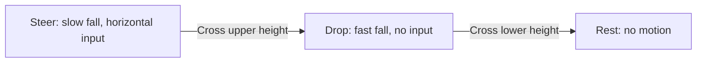

# How hybrid reachability works

[Home](../README.md) · [Run the tutorial](../tutorials/README.md) · [Paper examples](../examples/papers/README.md)

Suppose a robot needs to jump over an obstacle. Its future depends on its
position and velocity, the forces it can apply, and whether it is touching the
ground. Reachability asks which initial states admit a successful control
strategy over a given time horizon. It computes a field over many possible
initial states, rather than planning only one trajectory.

## The three questions

| Objective | Question | Example |
|---|---|---|
| Reach | Can I enter the goal by time T? | Jump onto a platform. |
| Avoid | Can I stay outside failure for the whole interval [0,T]? | Avoid the floor and obstacles. |
| Reach-avoid | Can I enter the goal by time T while avoiding failure until arrival? | Reach the other side of the pillars without collision. |

The goal may be reached before the horizon. For reach-avoid, failure at or
before arrival prevents success. The model determines what the goal means:
a position target does not also impose a terminal velocity unless you include
that requirement in the goal set.

## What makes a system hybrid?

A hybrid state consists of a continuous state `x` and a discrete mode `q`.
For the tutorial falling piece, `x=(horizontal_position, height)` and `q` is
steer, drop or rest. Each mode has its own continuous dynamics and allowable
controls.

A **guard** says when a transition is eligible. A **reset** says how the
continuous state changes when that transition occurs. The falling piece's
switches preserve position; only the mode changes.
A spacecraft switch also resets its clock.

Some transitions are **forced**, such as entering the fast-drop band. Others are **controlled**,
such as choosing to start a spacecraft thrust cycle. When a forced guard is
active, staying in the source mode is unavailable. A controlled transition
includes the option to stay.

These definitions belong in the model. You can add a new model without editing
the shared solver.

## What the solver computes

The value function `V(x,q,T)` assigns a number to each state, mode and remaining
horizon. Its zero contour separates the computed winning and losing regions.
The package uses the following signs:

| Data | Sign to look for |
|---|---|
| Input goal set | Negative inside the goal |
| Input failure set | Negative inside failure |
| Reach or reach-avoid result | `V <= 0` on the computed winning side |
| Avoid result | `V > 0` on the computed safe side |

For example, `abs(x - .9) - .3` describes the horizontal interval from .6 to
1.2. Combine it with a height interval using `maximum` to define a rectangle.
Take `minimum` across obstacle fields to describe their union. The `Problem` constructors apply the objective's signs
and optimization directions for you.

A zero value needs care, especially for reach-avoid: it alone does not prove
strict separation from a closed failure set. Simulation treats failure contact
as failure. These fields are numerical approximations whose accuracy depends
on resolution.

## Continuous motion and mode changes in one calculation

The solver builds a grid over the continuous coordinates and stores one value
field per mode. The mode is an array axis, not another spatial coordinate.
It then works backward from horizon zero:

1. Initialize the terminal goal/failure values and apply immediate resets.
2. Propagate each mode's field through its continuous dynamics with the HJ solver.
3. Couple the fields through guards and reset maps. A reset reads the destination
   mode's value at the reset state. Controlled transitions compare switching
   with staying; forced transitions exclude staying where their guards apply.
4. Repeat for each requested coupling interval, saving the selected checkpoints.

Goal and failure constraints enforce the chosen objective during propagation
and projection. Required resets take precedence over stopping in a source goal;
failure encountered along a reset path is retained.

If a model uses multiple projection stages, it explicitly specifies their
composition. The solver does not infer reset priority or repeatedly execute
cycles until they stop. See [the API reference](API.md) for these advanced
semantics.

## Turning the field into a trajectory

Once the fields are computed, a controller queries the value and its gradient
at the current state and **remaining** time. The gradient determines the
continuous control that optimizes the local Hamiltonian.

For reach and reach-avoid, this produces goal-seeking feedback. For avoid,
`AvoidFilter` supplies a **hybrid least-restrictive filter (HLRF)**: it evaluates
legal transition choices, passes through a nominal control when the selected
candidate's value exceeds the intervention margin, and uses safety feedback
otherwise. A positive margin requests earlier intervention. It is a numerical
buffer, not a bound on solver error.

The physical simulator integrates forward, locates guard events, applies
resets and queries control again in the resulting mode. As time passes, the
remaining horizon decreases. A finite-horizon field does not automatically
provide an indefinitely reusable safety controller.

## What changes when you refine a result?

Several resolutions affect different parts of the workflow:

| Setting | What it controls |
|---|---|
| Grid shape | Spatial approximation and reset sampling |
| Spacing of `horizons` | How often continuous propagation and hybrid projection are coupled |
| Saved checkpoints | Time interpolation available to feedback, and history storage |
| Feedback interval | How often controls and optional mode choices are recomputed in simulation |

Saving fewer checkpoints still executes every coupling interval. For large
problems, `solve_streamed` writes saved fields to disk in chunks. A successful
trajectory is useful evidence, but it does not establish convergence of the
whole computed set. The [validation record](VALIDATION.md) distinguishes those
claims.

Continue with the [falling-piece tutorial](../tutorials/README.md) to run this
pipeline and inspect its outputs.
