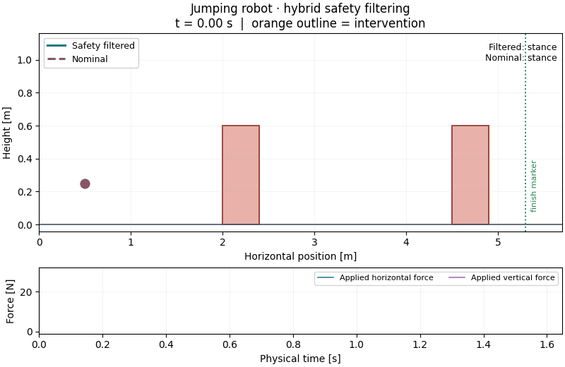
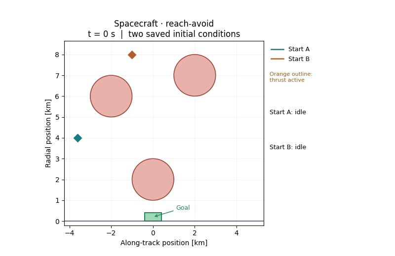

# Main-page paper-demo animations

[Home](../README.md) · [Paper experiment guide](../examples/papers/README.md#animate-a-completed-run)

These GIFs replay the previously saved, validated moderate-grid demo trajectories
recorded on 2026-10-25. They use the paper models and the public experiment
settings described in the [paper guide](../examples/papers/README.md).
The README previews were rendered on 2026-10-30 from those existing files.
No PDE solve, trajectory simulation, policy query or new numerical experiment
was performed for this update.

The [animation script](../examples/papers/animate.py) reads recorded geometry,
states, modes, controls and intervention flags. Displayed positions interpolate
linearly between saved physical samples. A marker represents the recorded point
state; its size is decorative. Each path stops at its recorded endpoint,
including the nominal collision. Physical time appears in each animation;
the two cases have different playback speeds.

Each GIF uses 121 sampled animation frames at 20 fps, followed by a 1 s final
hold. GIF encoding combines identical held frames. The JSON sidecars with
rendering metadata remain beside the generated files under `outputs/`.

## Jumper safety filtering

Saved case: `jump_avoid`, preset: `demo`.

The dashed nominal path collides at 0.770228 s; the safety-filtered path
passes both pillars at 1.647720 s. The finish marker is an avoid-rollout
stop condition, not a target in the avoid PDE. An orange outline marks
recorded continuous filter intervention; the lower panel shows the applied
filtered horizontal and vertical forces. The original coarse-grid clearance
limit remains documented in [VALIDATION.md](VALIDATION.md).

| Source file | SHA-256 |
|---|---|
| `jump_avoid_demo/configuration.json` | `744debf67b16620bf2e4d7cd699a7a565297835f31f2460fbaf24a2a733e1928` |
| `jump_avoid_demo/rollouts.json` | `dc4ff81786bdebba036d887bc0bcd584020c6e987470afa8275c1c413062b7ef` |
| `jump_avoid_demo/standard_filtered.npz` | `aca6b86507d5cde7c526819ada4a610bbd3016d2be3e288d0eb199ae53727115` |
| `jump_avoid_demo/standard_nominal.npz` | `6cbbdcccea0451d341966153b7dc76d3056c080cce7df26077c3607c6d29eb7b` |

GIF SHA-256: `ccfc937221cdd978fe5302417367b68cbc225b10033057b8b70a976c04067894`.

## Spacecraft reach-avoid

Saved case: `satellite_reach_avoid`, preset: `demo`.

Start A is the saved low-velocity initial condition and arrives at 758.990425 s.
Start B is the saved high-velocity initial condition and arrives at 723.490344 s.
The orange marker outline indicates thrust mode; labels distinguish idle,
thrust and cooldown. This is goal-seeking reach-avoid feedback.

| Source file | SHA-256 |
|---|---|
| `satellite_reach_avoid_demo/configuration.json` | `cafaf0231fa42d669d93dda12a7bb537d9d99bf4751378e019630b6b5bfab02d` |
| `satellite_reach_avoid_demo/rollouts.json` | `16fa8d3dc4a7c439e6af948a7053cb375e06fe4e7e1da8cedbbe7de5e1d0dad5` |
| `satellite_reach_avoid_demo/low_velocity_filtered.npz` | `a2c6f19f1d8d9ad7d9e3d42ec1339c5cff79c9483fd7ddc61544586b063846af` |
| `satellite_reach_avoid_demo/high_velocity_filtered.npz` | `0eb34609873d7addfbecccc498d99e35ba335cf2d5a0e0bac28151639cf984da` |

GIF SHA-256: `1c4131eae980796d02ad9c78bda3a461cd33ad6e8f73c442b568b31419ef2993`.
