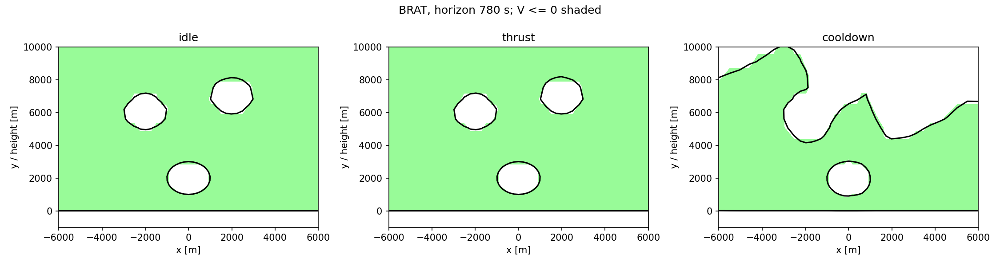
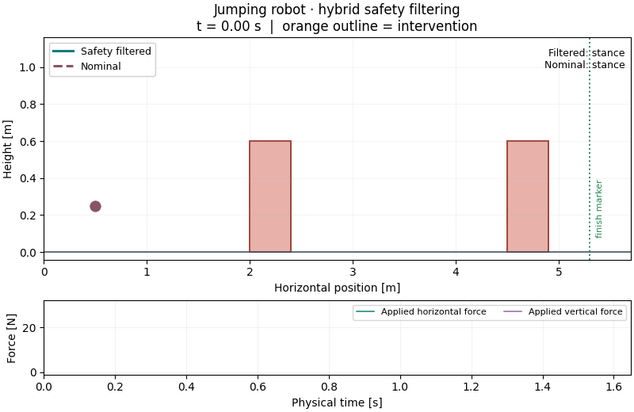
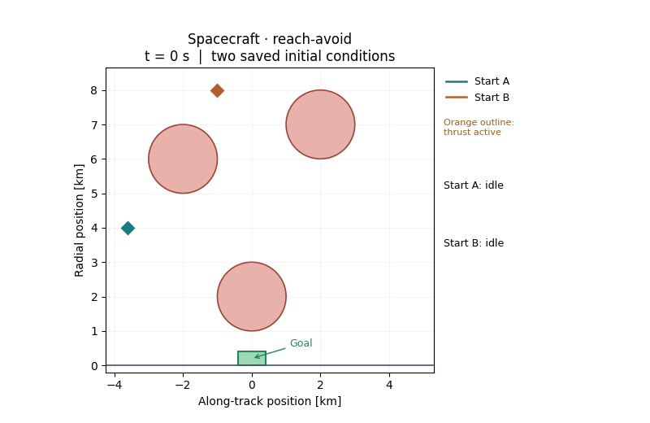

# Compute the paper BRTs and BRATs

[Home](../../README.md) · [Tutorial](../../tutorials/README.md) · [IJRR paper](https://doi.org/10.1177/02783649261477777) · [RSS paper](https://roboticsproceedings.org/rss20/p006.pdf)

Both the RSS and IJRR examples start by computing a value function. Its zero
level set bounds a backward reachable tube (BRT) or backward reach-avoid tube
(BRAT). First solve and plot these sets, then use the values for feedback or
safety filtering.

Follow the [setup guide](../../docs/SETUP.md) first. All commands run from the
repository root.

## 1. Compute the value function

[`run.py`](run.py) selects an example, builds its hybrid model and solves its
reachability problem. Start with a small CPU run from either paper:

```bash
# RSS: dog reaching the other side of a table
JAX_PLATFORMS=cpu JAX_ENABLE_X64=true \
  python examples/papers/run.py dog_absorbing --preset smoke
# IJRR: jumper reaching a goal while avoiding pillars
JAX_PLATFORMS=cpu JAX_ENABLE_X64=true \
  python examples/papers/run.py jump_reach_avoid --preset smoke
```

Each saves the initial and final value fields in
`outputs/papers/<case>_smoke/`. `smoke` uses a small grid; high-dimensional cases
also use short horizons. To compute the full-horizon tube on a larger grid,
use `reference`, for example with [CUDA JAX](../../docs/SETUP.md#gpu-execution):

```bash
JAX_PLATFORMS=cuda JAX_ENABLE_X64=true XLA_PYTHON_CLIENT_PREALLOCATE=false \
  python examples/papers/run.py jump_reach_avoid --preset reference
```

The same commands work for every case below: replace the case name to choose
an example from either paper.

| Paper | Case | Model called by `run.py` | Task | Reference horizon |
|---|---|---|---|---|
| RSS | `dog_absorbing`, `dog_recoverable` | [`dog1d.py`](../../src/hybrid_reach/examples/dog1d.py) | Reach the other side of a table | 3 s |
| RSS | `aircraft_fixed`, `aircraft_optimal` | [`aircoll3d.py`](../../src/hybrid_reach/examples/aircoll3d.py) | Avoid aircraft collision | 5 s |
| RSS | `jump_reach` | [`jump4d.py`](../../src/hybrid_reach/examples/jump4d.py) | Reach a platform | 1 s |
| IJRR | `jump_avoid` | [`jump_filter.py`](../../src/hybrid_reach/examples/jump_filter.py) | Avoid the floor and pillars | 4 s |
| IJRR | `jump_reach_avoid` | [`jump_reach_avoid.py`](../../src/hybrid_reach/examples/jump_reach_avoid.py) | Reach a target beyond the pillars | 2 s |
| IJRR | `satellite_avoid` | [`satellite.py`](../../src/hybrid_reach/examples/satellite.py) | Avoid obstacles and the lower boundary | 1200 s |
| IJRR | `satellite_reach_avoid` | [`satellite_reach_avoid.py`](../../src/hybrid_reach/examples/satellite_reach_avoid.py) | Reach a target around obstacles | 780 s |

Inside `run.py`, `make_case()` calls the corresponding module's `make_problem()`.
That supplies the dynamics, grid, guards, resets and sets. The script wraps these
in `Problem.reach(...)`, `Problem.avoid(...)` or `Problem.reach_avoid(...)`,
then calls `solve(...)`.
To change the system, edit its model module; to change the solve's grid or
horizon, edit `make_case()`.

The RSS examples explore walking/crawling switches, aircraft turn timing and
platform jumping. The IJRR examples add safety filtering and reach-avoid for
a jumper and a spacecraft with thrust/cooldown switches.

Read the computed field using the same signs as the tutorial:

- **Reach:** `V <= 0` is the BRT of states that can reach the goal.
- **Avoid:** `V <= 0` is the failure BRT; `V > 0` is the safe set.
- **Reach-avoid:** `V <= 0` is the BRAT, from which the target can be reached
  while avoiding failure within the horizon.

Use a fresh output directory for reruns. For `run.py`, `--output outputs/my_values`
sets the parent directory; the script appends `<case>_<preset>`.
Reference grids can be expensive and have not all been validated. `--memory-gib`
sets the execution-estimate budget (default 4 GiB).

## 2. Plot BRT / BRAT slices

Dog1D has one position coordinate: plot its value against position. For the
other examples, plot a position plane while fixing the remaining coordinates:
the aircraft's turn timer, the jumper's velocities, or the spacecraft's
velocities and clock. Each mode gets its own panel.

This snippet works for **all nine cases**. Change the result path to choose an
RSS or IJRR result, including a `reference` run:

```python
import numpy as np
import matplotlib.pyplot as plt
from hybrid_reach import Result

result = Result.load('outputs/papers/dog_absorbing_smoke')
# Satellite grids use asinh coordinates; decode the position axes for plotting.
scales = {'satellite_avoid': (6000., 6000.),
          'satellite_reach_avoid': (2500., 2000.)}.get(result.metadata['case'])
coordinates = list(result.coordinates)
if scales is not None:
    coordinates[:2] = [scale*np.sinh(axis)
                       for scale, axis in zip(scales, coordinates[:2])]
x = coordinates[0]

# Fix remaining coordinates at their grid samples nearest zero.
fixed = tuple(int(np.argmin(abs(axis))) for axis in result.coordinates[2:])
fig, axes = plt.subplots(1, len(result.mode_names), squeeze=False,
                         figsize=(5*len(result.mode_names), 4))
color = 'salmon' if result.kind == 'avoid' else 'palegreen'
for q, ax in enumerate(axes[0]):
    if len(coordinates) == 1:
        field = result.values[-1, q]
        ax.plot(x, field)
        ax.axhline(0., color='black')
        ax.fill_between(x, field, 0., where=field <= 0, color=color, interpolate=True)
        ax.set_ylabel('Value V')
    else:
        y = coordinates[1]
        field = result.values[(-1, q, slice(None), slice(None), *fixed)]
        ax.contourf(x, y, (field <= 0).T, levels=[-.5, .5, 1.5],
                    colors=['white', color])
        if field.min() < 0 < field.max():
            ax.contour(x, y, field.T, levels=[0.], colors='black')
        ax.set_ylabel('y / height [m]')
    ax.set(title=result.mode_names[q], xlabel='x [m]')
tube = 'BRAT' if result.kind == 'reach_avoid' else 'BRT'
fig.suptitle(f'{tube}, horizon {result.horizons[-1]:g} s; V <= 0 shaded')
fig.tight_layout()
fig.savefig('value_slices.png', dpi=150)
```

`result.values` is indexed by `(saved horizon, mode, *state coordinates)`.
`-1` selects the full computed horizon. Change `fixed` to inspect other velocities
or timer/clock phases. Dog1D shades the part of the curve inside the BRT; the
other cases shade the BRT/BRAT in the position plane. A short `smoke` horizon
may show only a small part of the tube.

The saved spacecraft reach-avoid demo gives these BRAT slices at 780 s, with
velocities nearest zero and clock phase zero. Green marks `V <= 0`:



## 3. Use the values as feedback or a safety filter

The ready-made trajectory workflow currently covers the four IJRR cases. RSS
values and slices use the steps above; dedicated RSS trajectory drivers are
still pending.

A trajectory queries the field at decreasing time-to-go, so it needs saved
intermediate horizons. `run.py` saves only the endpoints. For feedback, prepare
a time history with [`rollouts.py`](rollouts.py) in solve-only mode:

```bash
JAX_PLATFORMS=cuda JAX_ENABLE_X64=true XLA_PYTHON_CLIENT_PREALLOCATE=false \
  python examples/papers/rollouts.py jump_reach_avoid --preset demo --solve-only
```

This computes a new field using the moderate `demo` grid and saves its history
in `outputs/papers/jump_reach_avoid_demo/value/`. It does not reuse the
endpoint-only `run.py` result. [`scenarios.py`](scenarios.py) defines these grids,
horizons, initial states and feedback intervals. `demo` horizons are 3 s for
jumper avoid, 2 s for jumper reach-avoid, 1200 s for spacecraft avoid and 780 s
for spacecraft reach-avoid. For a short CPU check, set `JAX_PLATFORMS=cpu`
and use `--preset smoke`.

Then follow the feedback and draw trajectories without solving again:

```bash
JAX_PLATFORMS=cpu JAX_ENABLE_X64=true \
  python examples/papers/rollouts.py jump_reach_avoid --preset demo --rollouts-only
JAX_PLATFORMS=cpu JAX_ENABLE_X64=true \
  python examples/papers/validate.py jump_reach_avoid --preset demo
```

Replace the case in all three commands to run any other IJRR example:

**Safety filtering (`jump_avoid`):** apply the nominal policy when safe;
otherwise use the safety feedback. The filtered jumper clears the pillars;
the dashed nominal trajectory collides.



**Reach-avoid (`satellite_reach_avoid`):** choose continuous inputs and available
mode switches using the value function to reach the goal without collision.
Both spacecraft starts reach the target around the obstacles.



The [model adapters](../../src/hybrid_reach/examples/adapters.py) build the
controllers and integrate the physical dynamics. Edit `Scenario.nominal()` in
[`scenarios.py`](scenarios.py) to filter your own admissible nominal policy.
The safety filter is available for avoid only.

Open `trajectories.png` in the run directory. `value_slices.png` shows slices
at the first initial state's velocity and phase; `diagnostics.png` shows values,
modes and controls over time. `validate.py` independently replays the saved
controls and records clearance and goal-arrival checks in `validation.json`.
Use the same case, preset and `--output` directory for all three commands.

These are finite-grid results, and exact paper-figure reproduction is incomplete.
The recorded demo trajectories pass independent checks, but the jumper avoid
run has tight clearance. See the [validation record](../../docs/VALIDATION.md)
for measured outcomes and grids. Short smoke runs need not reach the goal.

## 4. Animate the trajectories

After completing the corresponding runs:

```bash
python examples/papers/animate.py outputs/papers/jump_avoid_demo \
  --output outputs/animations/jumper_filter.gif
python examples/papers/animate.py outputs/papers/satellite_reach_avoid_demo \
  --output outputs/animations/satellite_reach_avoid.gif
```

This renders saved paths. Use a fresh output path; `--frames`, `--fps` and
`--hold` adjust playback.
