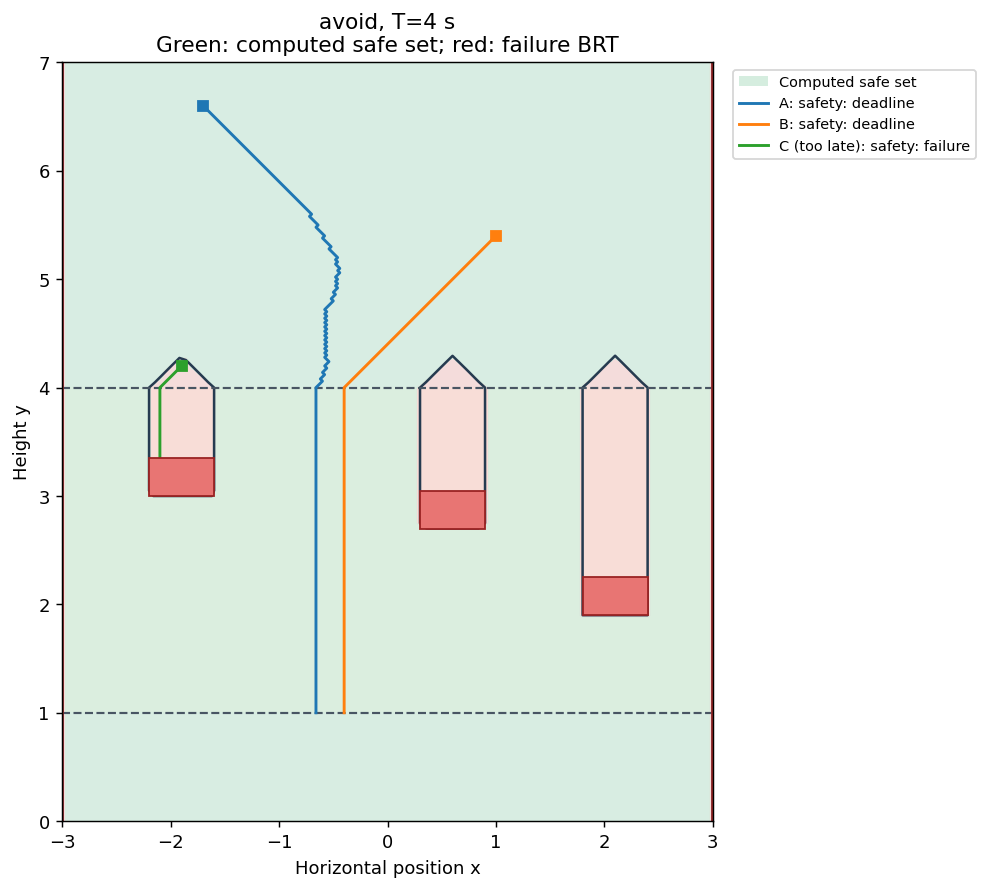

# Avoid: choose a column with no collision

[Model](README.md) → [Reach](REACH.md) → **Avoid and filter** → [Reach-avoid](REACH_AVOID.md)

## Predict the answer

Replace the target task with several red rectangles in the drop band. Once the
piece loses steering, any obstacle in its column below it is unavoidable.
Above `y=4`, it can still steer into a gap. Obstacles therefore cast vertical
failure shadows in the drop band, with regions of recoverable states above.

Here the question is: **“Can I avoid every obstacle for the next 4 seconds?”**
The rest band is safe. Falling to it is automatic: even from `y=7`, the trip
takes at most `3/1 + 3/5 = 3.6 s`. We do not add a goal to the avoid objective.

## Code obstacles and walls

The rectangle function from [reach](REACH.md#code-the-goal-set) is negative
inside one obstacle. Taking the **minimum** of several fields describes their
union: being inside any one is failure. We also make contact with the side
walls at `x=-3` and `x=3` failure. The bottom band is deliberately safe.

```python
import jax.numpy as jnp
from hybrid_reach.examples.falling_piece import rectangle

obstacles = ((-2.2, -1.6, 3., 3.35),
             (.3, .9, 2.7, 3.05),
             (1.8, 2.4, 1.9, 2.25))

def failure(states, mode):
    x = states[..., 0]
    field = jnp.minimum(x+3., 3.-x)
    for bounds in obstacles:
        field = jnp.minimum(field, rectangle(states, bounds))
    return field
```

Numerical boundary extrapolation does not create these walls; the failure
function does. The physical simulator treats contact (`failure <= 0`) as a
collision.

## Solve and choose maximum-safety feedback

Now we want to maximize the worst clearance along the trajectory. The same
`FallingDynamics` optimizer switches from minimizing to maximizing `Vx*u`.
In the steering band its safety input is `u=+sign(Vx)`.

```python
import numpy as np
from hybrid_reach import Problem, solve, AvoidFilter
from hybrid_reach.examples.falling_piece import make_system

model, grid, events = make_system()
problem = Problem.avoid(model, grid, failure)
result = solve(problem, np.linspace(0., 4., 401),
               save_indices=tuple(range(0, 401, 5)))
hlrf = AvoidFilter(problem, result, margin=.12)

def maximum_safety(state, mode, time_to_go):
    return hlrf(state, mode, time_to_go,
        nominal_control=lambda x, q: hlrf.policy.control(x, q, time_to_go)[0])
```

Here we pass the maximum-safety control itself as the callback, so it runs
throughout the trajectory. The same filter will shortly let us protect a
different controller.

For avoid, **`V > 0` is the computed safe set**. The complementary `V <= 0`
region is the failure BRT. This sign differs from reach; the plot labels both
regions explicitly.

## Run and inspect the safety policy

```bash
JAX_PLATFORMS=cpu JAX_ENABLE_X64=true \
  python tutorials/falling_piece.py --kind avoid
```

Open `outputs/falling_piece/avoid/brt.png` and `policy.gif`. Use a new
`--output` directory if you already ran another task with the default path.




A and B steer into clear columns and complete the horizon in rest mode. C starts
at `(-1.9,4.2)`: only 0.2 s of steering remains, insufficient to clear the first
obstacle's horizontal span. Its collision demonstrates why feedback cannot
rescue every initial state.

## Protect an arbitrary policy with the safety filter

Maximum-safety behavior may differ from what you actually want the piece to do.
Suppose an existing controller prefers drifting right. We would like to keep
that input while there is room to recover, then intervene before the steering
window closes.

First code the nominal policy. Its output must belong to the current mode's
input box, including returning zero after steering is lost:

```python
def nominal_control(state, mode):
    return np.array([.8 if mode == 0 else 0.])
```

Next wrap it with the hybrid least-restrictive filter. Above the margin it passes
the nominal input through; at or below the margin it uses the safety optimizer:

```python
def filtered_control(state, mode, time_to_go):
    return hlrf(state, mode, time_to_go, nominal_control=nominal_control)
```

`nominal_control` receives the **post-reset** state and mode. This matters at
`y=4`: the callback must now return zero, even if the previous steering input
was nonzero. You can replace the callback with another admissible policy without
changing the HJ solve.

Then simulate with failure events just as we supplied goal events for reach:

```python
from hybrid_reach import simulate
from hybrid_reach.examples.falling_piece import physical_flow

trajectory = simulate(
    problem, filtered_control, [-1.7, 6.6], 0,
    duration=4., feedback_dt=.02, events=events, flow=physical_flow,
    fixed_axes=lambda q: () if q == 0 else ((0,) if q == 1 else (0, 1)),
    failure=lambda x, q: float(failure(x, q)),
)
print(trajectory['status'])
```

The avoid command also writes `filter.gif`, comparing the unfiltered and
filtered policy from the **same** initial condition:


Orange outlines mark filter intervention. The nominal piece enters a blocked
column; the filtered piece changes course before losing steering and rests
without collision. Look at `continuous_interventions` and the independent
segment audit in `summary.json` alongside the animation.

The margin `.12` is a numerical intervention buffer, not a certified error
bound. If every legal candidate is unsafe, the filter still takes its best
available action and reports `safe_candidate=False`. These are finite-grid,
sampled-feedback examples. Next, [add a target below the obstacles](REACH_AVOID.md).
