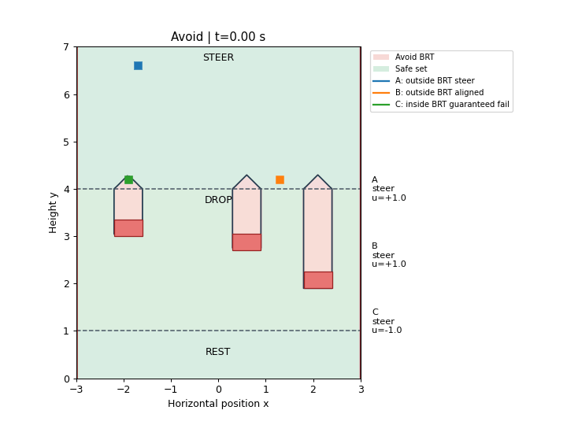
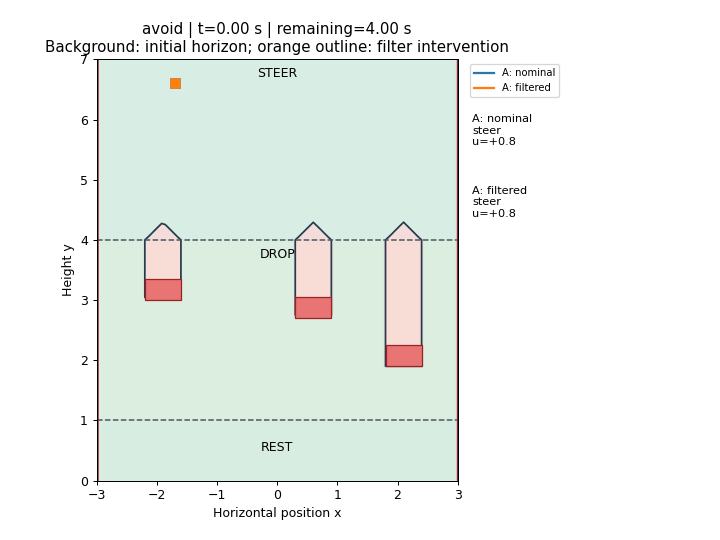

# Avoid: choose a column with no collision

[Model](README.md) → [Reach](REACH.md) → **Avoid and filter** → [Reach-avoid](REACH_AVOID.md)

## Code the failure set

The rectangle function from [reach](REACH.md#code-the-goal-set) is negative
inside an obstacle. Taking the minimum describes the union: entering any
obstacle is failure. We also include the side walls; the rest band stays safe.

```python
import jax.numpy as jnp
from hybrid_reach.examples.falling_piece import rectangle

obstacles = ((-2.2, -1.6, 3., 3.35),
             (.3, .9, 2.7, 3.05),
             (1.8, 2.4, 1.9, 2.25))

def failure(states, mode):
    x = states[..., 0]
    field = jnp.minimum(x+3., 3.-x)
    for bounds in obstacles:
        field = jnp.minimum(field, rectangle(states, bounds))
    return field
```

## Compute the backward reachable tube

The **avoid BRT** contains states from which collision is unavoidable within
the horizon. Unlike reach, **`V <= 0` is the failure BRT; `V > 0` is the safe set**.
The controller maximizes safety, so steer mode uses `u=+sign(Vx)`.

```python
import numpy as np
from hybrid_reach import Problem, solve, AvoidFilter
from hybrid_reach.examples.falling_piece import make_system

model, grid, events = make_system()
problem = Problem.avoid(model, grid, failure)
horizons = np.linspace(0., 4., 401)
result = solve(problem, horizons, save_indices=tuple(range(0, 401, 5)))
```

`Problem.avoid` selects maximizing control. The coupling and saved-frame
intervals are the same as reach. No goal is needed: falling to rest is automatic.

## Turn the field into feedback

`AvoidFilter` handles forced switches and queries the safety policy. Passing
the safety input itself as the nominal callback runs maximum-safety feedback:

```python
hlrf = AvoidFilter(problem, result, margin=.12)

def maximum_safety(state, mode, time_to_go):
    return hlrf(state, mode, time_to_go,
        nominal_control=lambda x, q: hlrf.policy.control(x, q, time_to_go)[0])
```

Simulate with failure events to stop at collision. This helper also lets us
compare controllers from the same initial condition:

```python
from hybrid_reach import simulate
from hybrid_reach.examples.falling_piece import physical_flow

def rollout(controller):
    return simulate(
        problem, controller, [-1.7, 6.6], 0,
        duration=4., feedback_dt=.02, events=events, flow=physical_flow,
        fixed_axes=lambda q: () if q == 0 else ((0,) if q == 1 else (0, 1)),
        failure=lambda x, q: float(failure(x, q)),
    )

trajectory = rollout(maximum_safety)
print(trajectory['status'])
```

## Run and inspect

```bash
JAX_PLATFORMS=cpu JAX_ENABLE_X64=true \
  python tutorials/falling_piece.py --kind avoid
```

Open `outputs/falling_piece/avoid/policy.gif`. Use a fresh `--output` directory
for reruns. The command also saves the value history, trajectories and summary.



| Start | Expected behavior |
|---|---|
| A: outside BRT steer, `(-1.7,6.6)` | Steers into a gap; finishes safely |
| B: outside BRT aligned, `(1.3,5.4)` | Starts in a clear column; finishes safely |
| C: inside BRT guaranteed fail, `(-1.9,4.2)` | Too little steering time; collides |

The GIF shows the initial-horizon avoid BRT in red and the safe set in green.
Its clock shows physical time. A and B complete the 4 s horizon in rest mode.

## Protect a nominal policy with the filter

Suppose a controller prefers drifting right. The filter passes that input
through above the margin and uses safety feedback at or below it:

```python
def nominal_control(state, mode):
    return np.array([.8 if mode == 0 else 0.])

def filtered_control(state, mode, time_to_go):
    return hlrf(state, mode, time_to_go, nominal_control=nominal_control)

filtered_trajectory = rollout(filtered_control)
```

The callback receives the post-reset state and mode, so it must return zero
after steering is lost. The margin `.12` is an intervention buffer.

The same command writes `filter.gif`, comparing nominal and filtered control:



Both start at A, outside the failure BRT. The nominal policy still collides;
the filter intervenes before the drop and finishes safely. Orange outlines
mark intervention. Continue to [reach-avoid](REACH_AVOID.md).
