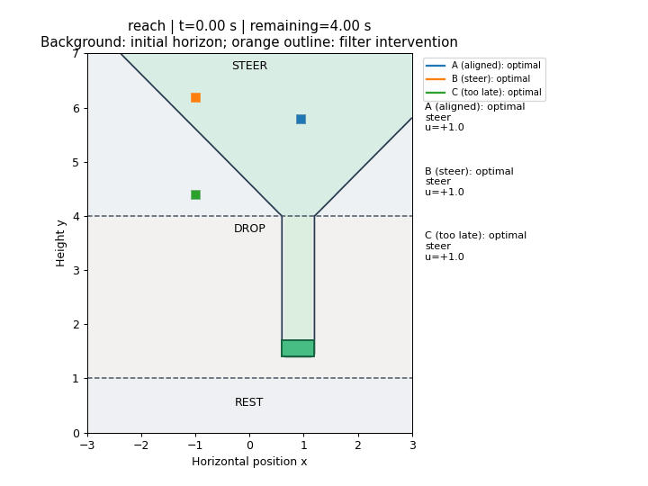

# Reach: choose a column that intersects the target

[Model](README.md) → **Reach** → [Avoid and filter](AVOID.md) → [Reach-avoid](REACH_AVOID.md)

## Code the goal set

We describe a rectangle with a function that is negative inside, zero on its
boundary and positive outside. Each expression below is negative on the inward
side of one face; taking their maximum requires all four conditions at once:

```python
import jax.numpy as jnp

def rectangle(states, bounds):
    left, right, bottom, top = bounds
    x, y = states[..., 0], states[..., 1]
    return jnp.maximum(jnp.maximum(left-x, x-right),
                       jnp.maximum(bottom-y, y-top))

def goal(states, mode):
    return rectangle(states, (.6, 1.2, 1.4, 1.7))
```

The `...` lets the same function accept a single `[x,y]` or a batch of grid
states. This goal is independent of mode. It is a position target, with no
extra terminal-velocity condition.

## Compute the backward reachable tube

The **backward reachable tube (BRT)** is the set of initial states from which
the piece can reach the target within the horizon. The solver propagates goal
information backward through fast falling and then through steering.

Continue with the goal function above and the model built on the previous page:

```python
import numpy as np
from hybrid_reach import Problem, solve, Result
from hybrid_reach.examples.falling_piece import make_system

model, grid, events = make_system()
problem = Problem.reach(model, grid, goal)
horizons = np.linspace(0., 4., 401)
result = solve(problem, horizons, save_indices=tuple(range(0, 401, 5)))
```

`Problem.reach` selects minimizing control. Adjacent horizons are 0.01 s hybrid
coupling intervals. Saving every fifth frame gives feedback a 0.05 s history.
The saved array has shape `(81, 3, 101, 141)`: horizon, mode, x, y.

For this objective, **`V <= 0` is the computed reach BRT**.

## Turn the field into feedback

A BRT tells us where success is possible. To move the actual piece, we need to
query the value function at its current position and remaining time, estimate
the spatial gradient, and apply the Hamiltonian optimizer we coded in `FallingDynamics`.

`ContinuousFeedback` performs those queries and handles the forced mode path:

```python
from hybrid_reach import ContinuousFeedback, simulate
from hybrid_reach.examples.falling_piece import physical_flow

controller = ContinuousFeedback(problem, result)
trajectory = simulate(
    problem, controller, [-1., 6.2], 0,
    duration=4., feedback_dt=.02, events=events, flow=physical_flow,
    fixed_axes=lambda q: () if q == 0 else ((0,) if q == 1 else (0, 1)),
    goal=lambda x, q: float(goal(x, q)),
)
print(trajectory['status'])
```

In steer mode, the policy chooses `u=-sign(Vx)`. In drop and rest modes, the input is zero.
`fixed_axes` tells event detection which coordinates are held exactly constant;
it does not change the dynamics. The numerical integrator locates switches before it
continues in a new mode. Remaining time decreases from 4 s, rather than querying
the initial-horizon field forever.

## Run and inspect

After [installation](../docs/SETUP.md), run from the repository root:

```bash
JAX_PLATFORMS=cpu JAX_ENABLE_X64=true \
  python tutorials/falling_piece.py --kind reach
```

The command produces `outputs/falling_piece/reach/brt.png`, `policy.gif`,
`summary.json`, numerical trajectories and `value/`. For a rerun, add a new
`--output outputs/reach_second_run`. Running without `--kind` generates all tasks.



The three initial conditions tell different stories:

| Start | Expected behavior |
|---|---|
| A: inside BRT aligned, `(0.95,5.8)` | Already aligned; reaches the target |
| B: inside BRT steer, `(-1,6.2)` | Steers right before the switch; reaches the target |
| C: outside BRT guaranteed fail, `(-1,4.4)` | Too little steering time; misses and comes to rest |

The GIF retains the **initial-horizon BRT** in the background as a reference.
Its clock shows physical time.

Small zigzags in the steering band reflect switching of the gradient-based
input on the finite grid and feedback samples. The drop segments stay vertical.

Continue to [avoidance and the safety filter](AVOID.md).
