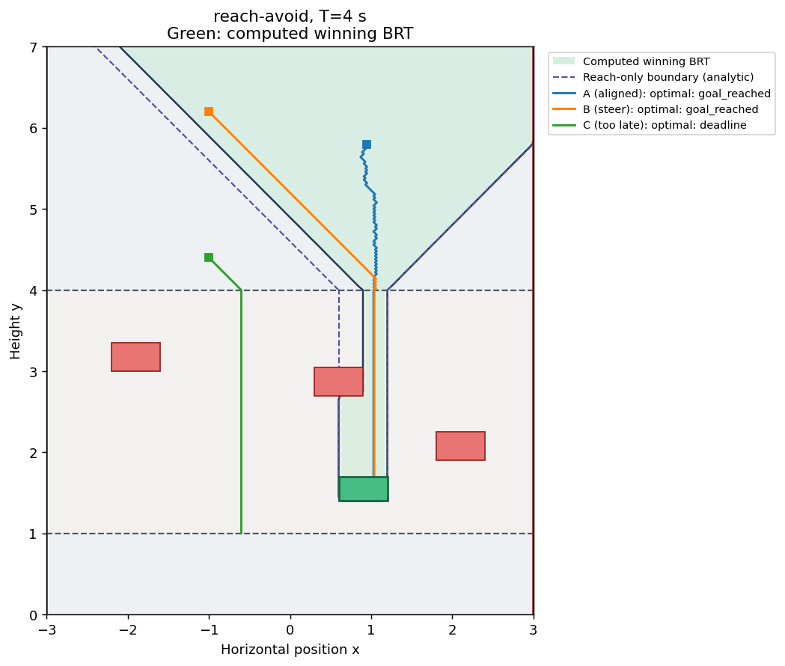

# Reach-avoid: choose a clear column that also reaches the goal

[Model](README.md) → [Reach](REACH.md) → [Avoid and filter](AVOID.md) → **Reach-avoid**

## Predict the answer

Now keep the obstacles and restore the same green target below them. Aligning
with the target is no longer sufficient: the piece must also pass through a
clear column before arrival.

The target spans `x=0.6` to `1.2`. The middle obstacle spans `x=0.3` to `0.9`
above it. Thus a piece entering the drop band must use the target's **right-hand
part**, beyond `x=0.9`. A piece already below that obstacle may still reach the
left-hand part. This is the difference we should see when comparing reach and
reach-avoid.

## Combine the existing sets

Reach-avoid minimizes the goal cost while retaining failure constraints along
the path. We reuse both set functions, with the same negative-inside convention.
Failure contact takes priority over goal contact.

```python
import numpy as np
from hybrid_reach import Problem, solve, ContinuousFeedback
from hybrid_reach.examples.falling_piece import make_system, goal, failure

model, grid, events = make_system()
problem = Problem.reach_avoid(model, grid, goal, failure)
result = solve(problem, np.linspace(0., 4., 401),
               save_indices=tuple(range(0, 401, 5)))
controller = ContinuousFeedback(problem, result)
```

For this objective, the computed winning set is again on the `V <= 0` side.
The controller uses the same minimizing Hamiltonian rule as reach, now with a
field that accounts for failure. This is goal-seeking feedback; the safety-filter
extension in the previous lesson applies to avoid only.

## Simulate with both goal and failure events

The physical simulation must stop on either target arrival or collision.
Passing both functions ensures a trajectory cannot be reported as successful
just because its endpoint lies in the target.

```python
from hybrid_reach import simulate
from hybrid_reach.examples.falling_piece import physical_flow

trajectory = simulate(
    problem, controller, [-1., 6.2], 0,
    duration=4., feedback_dt=.02, events=events, flow=physical_flow,
    fixed_axes=lambda q: () if q == 0 else ((0,) if q == 1 else (0, 1)),
    goal=lambda x, q: float(goal(x, q)),
    failure=lambda x, q: float(failure(x, q)),
)
print(trajectory['status'])
```

## Run and compare

```bash
JAX_PLATFORMS=cpu JAX_ENABLE_X64=true \
  python tutorials/falling_piece.py --kind reach_avoid
```

Open `outputs/falling_piece/reach_avoid/brt.png` and `policy.gif`. Use a fresh
`--output` directory on reruns.



The dashed purple lines retain the analytic reach-only boundary for the same
goal. The green reach-avoid region narrows because some target-aligned columns
hit the obstacle first. Below the blocking obstacle, the winning column widens
again. The bottom rest band cannot reach this higher target.


A and B reach the target without collision. C lacks enough steering time and
misses, even though its trajectory avoids the obstacles. A safe miss is still
a failure of the reach-avoid task. `summary.json` records that outcome as
`deadline`, not `goal_reached`.

## Check more than the animation

Every task saves numerical trajectories, reset records, solver metadata and an
independent straight-line replay audit. For avoid/reach-avoid the audit minimizes
the rectangle failure field over each entire straight segment, so it can detect
an obstacle crossed between safe sampled endpoints. Numerical boundary contact
and a finite-grid BRT still require care; this is not an interval proof of the
whole reachable set.

Try moving the blocking obstacle sideways, widening the target, or reducing
steering speed in `Parameters`. Predict the new clear columns before solving.
Change grid resolution, coupling time and feedback interval separately when
checking numerical sensitivity. The CLI exposes `--shape NX NY`, `--horizon`
and `--frames`; the last changes GIF rendering only.

All examples use the shared solver and controller classes. The model is in
[`falling_piece.py`](../src/hybrid_reach/examples/falling_piece.py), the experiment
and output code in [`tutorials/falling_piece.py`](falling_piece.py), and the
plotting/GIF code in [`falling_piece_figures.py`](falling_piece_figures.py).
Continue with the [paper guide](../examples/papers/README.md) or the
[planar jumper](PLANAR_JUMPER.md) for more involved models.
