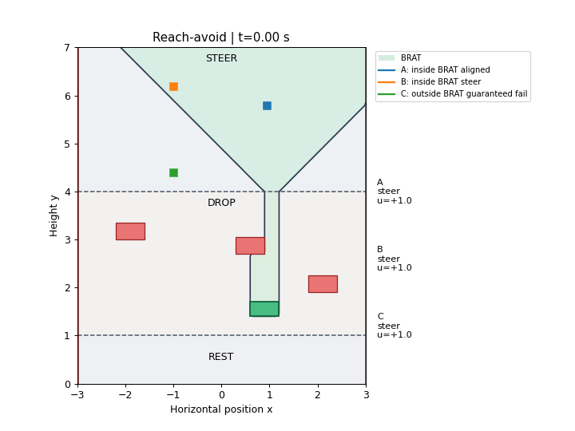

# Reach-avoid: choose a clear column that also reaches the goal

[Model](README.md) → [Reach](REACH.md) → [Avoid and filter](AVOID.md) → **Reach-avoid**

## Code the goal and failure sets

Reuse the target from reach and the obstacles from avoid. The obstacle above
the target blocks its left-hand columns, so alignment alone is insufficient.
Both input functions keep the negative-inside convention:

```python
from hybrid_reach.examples.falling_piece import goal, failure
```

The goal spans `x=0.6` to `1.2`; the blocking obstacle spans `x=0.3` to `0.9`.
A piece dropping from above must therefore use the target's right-hand part.

## Compute the backward reach-avoid tube

The **backward reach-avoid tube (BRAT)** contains states from which the target
can be reached within the horizon without collision before arrival.

```python
import numpy as np
from hybrid_reach import Problem, solve
from hybrid_reach.examples.falling_piece import make_system

model, grid, events = make_system()
problem = Problem.reach_avoid(model, grid, goal, failure)
horizons = np.linspace(0., 4., 401)
result = solve(problem, horizons, save_indices=tuple(range(0, 401, 5)))
```

`Problem.reach_avoid` selects minimizing control while retaining failure
constraints. For this objective, **`V <= 0` is the computed BRAT**.

## Turn the field into feedback

Use `ContinuousFeedback` as in reach, now with a field that accounts for
obstacles. Supply both goal and failure events to the simulator:

```python
from hybrid_reach import ContinuousFeedback, simulate
from hybrid_reach.examples.falling_piece import physical_flow

controller = ContinuousFeedback(problem, result)
trajectory = simulate(
    problem, controller, [-1., 6.2], 0,
    duration=4., feedback_dt=.02, events=events, flow=physical_flow,
    fixed_axes=lambda q: () if q == 0 else ((0,) if q == 1 else (0, 1)),
    goal=lambda x, q: float(goal(x, q)),
    failure=lambda x, q: float(failure(x, q)),
)
print(trajectory['status'])
```

In steer mode, the policy chooses `u=-sign(Vx)`. In drop and rest modes, the
input is zero. Failure contact takes priority over goal arrival. This is
goal-seeking feedback; the safety filter in the previous section is avoid-only.

## Run and inspect

```bash
JAX_PLATFORMS=cpu JAX_ENABLE_X64=true \
  python tutorials/falling_piece.py --kind reach_avoid
```

Open `outputs/falling_piece/reach_avoid/policy.gif`. Use a fresh `--output`
directory for reruns. The command also saves the value history, trajectories
and summary.



| Start | Expected behavior |
|---|---|
| A: inside BRAT aligned, `(0.95,5.8)` | Reaches the target without collision |
| B: inside BRAT steer, `(-1,6.2)` | Steers into a clear target column; reaches it |
| C: outside BRAT guaranteed fail, `(-1,4.4)` | Too little steering time; misses the target |

The GIF retains the initial-horizon BRAT in green. Its clock shows
physical time. Below the blocking obstacle, the winning column widens again.
C avoids collision but misses the target, so it still fails the reach-avoid task.

Continue to the [paper examples](../examples/papers/README.md).
