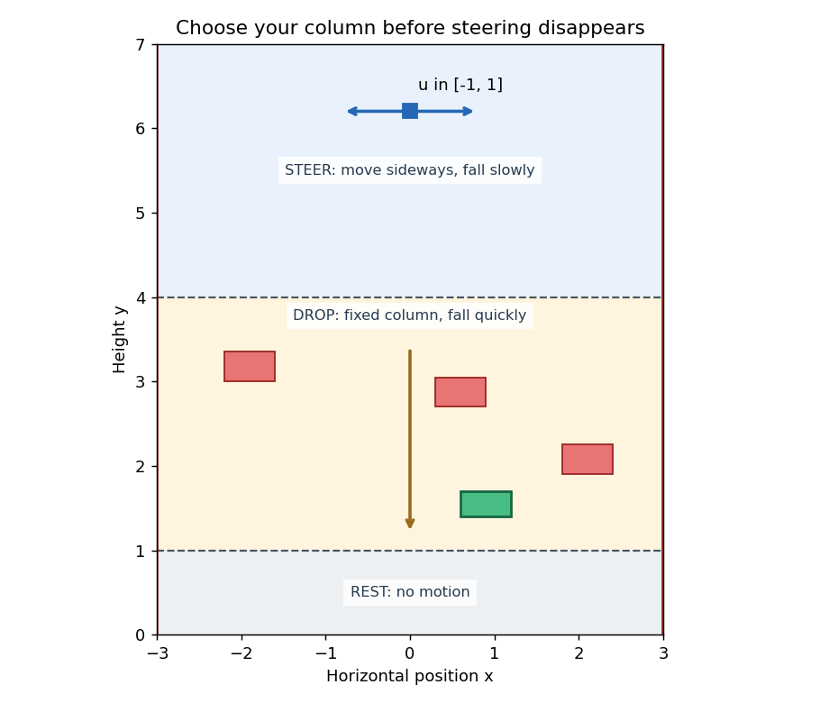

# Tutorial: steer a falling piece before the drop

[Home](../README.md) · **1. Model** → [2. Reach](REACH.md) → [3. Avoid and filter](AVOID.md) → [4. Reach-avoid](REACH_AVOID.md)

**Can you move a falling piece into the right column before you lose steering?**

Imagine a simple falling-block game. High up, you can move sideways. After
crossing a line, the piece drops quickly in its chosen column. At the bottom it
stops. Reaching a target or missing an obstacle therefore depends on a decision
you must make *before* the drop.

This lesson first builds this hybrid model. The next pages use it to reach a
target, avoid obstacles, and combine both.

## 1. Understand the three bands



The state is the position `(x,y)` of the falling piece. The input directly sets
horizontal speed when steering is available. Vertical speed depends on the mode:

| Mode | Physical band | Motion | Input |
|---|---|---|---|
| `0`, steer | `y > 4` | `xdot = u`, `ydot = -1` | `-1 <= u <= 1` |
| `1`, drop | `1 < y <= 4` | `xdot = 0`, `ydot = -5` | `u = 0` |
| `2`, rest | `y <= 1` | `xdot = 0`, `ydot = 0` | `u = 0` |

At `y=4` you lose steering; at `y=1` you stop. Position stays continuous at both
switches. This is a **hybrid system** because the continuous motion changes
when the discrete mode changes.

The complete runnable model is
[`hybrid_reach/examples/falling_piece.py`](../hybrid_reach/examples/falling_piece.py).
The snippets below explain the core parts.

## 2. Code the continuous dynamics

We subclass `hj_reachability.Dynamics`. Its control space describes the inputs
available in each mode. The disturbance space is empty because this particular example
has no adversary. This is the beginning of `FallingDynamics`:

```python
import hj_reachability as hj
import jax.numpy as jnp
from hybrid_reach.examples.falling_piece import Parameters, STEER, DROP, REST

class FallingDynamics(hj.Dynamics):
    def __init__(self, mode, parameters=Parameters()):
        self.mode, self.p = mode, parameters
        self.horizontal_speed = parameters.u_max if mode == STEER else 0.
        self.fall_speed = (parameters.slow_speed, parameters.fast_speed, 0.)[mode]
        control_space = hj.sets.Box(jnp.array([-self.horizontal_speed]),
                                    jnp.array([self.horizontal_speed]))
        disturbance_space = hj.sets.Box(jnp.zeros(0), jnp.zeros(0))
        super().__init__("min", "max", control_space, disturbance_space)

    def __call__(self, state, control, disturbance, time):
        vx = control[0] if self.mode == STEER else 0.
        return jnp.array([vx, -self.fall_speed])
```

`state` is `[x,y]` and `control` is a one-element array `[u]`. The returned array
is `[xdot,ydot]`. Both inactive modes have the input box `[0,0]`, because a controller
cannot steer after the first switch.

## 3. Tell the solver how to choose an optimal input

The ability to reach or avoid a set in the future from a given state, as in classical HJ reachability,
is encoded in a value function `V`, which captures how far we can get into or stay outside the set under optimal decision-making.
Its horizontal derivative `Vx` tells us how moving right changes that score.

The convention is that the implicit functions that capture the goal/failure sets are negative within the set,
and positive outside of it, with their zero-level set representing the boundary of the set.
Because of this, for goal seeking we want to minimize this score (move towards negative values); for avoidance, we maximize it (move away from negative values). For reach-avoid, the convention is to keep the definition for the goal and make the obstacles positive inside and negative outside, so the controller minimizes in this case (moving towards the negative goal and away from the positive obstacles).

In the steering band, the Hamiltonian is `H = Vx*u - Vy`. Only `Vx*u` depends
on the input. To minimize it, move left when `Vx>0` and right when `Vx<0`.
To maximize it, reverse those choices. At `Vx=0`, zero is an admissible optimal
choice. In the other bands, we don't have access to any control, so the input is zero.

That reasoning becomes this method inside `FallingDynamics`:

```python
    def optimal_control_and_disturbance(self, state, time, grad_value):
        direction = -1. if self.control_mode == "min" else 1.
        control = direction*self.horizontal_speed*jnp.sign(grad_value[0])
        return jnp.array([control]), jnp.zeros(0)
```

The `Problem` constructor sets `self.control_mode`: `min` for reach/reach-avoid,
`max` for avoid. We implement both directions here so the same dynamics class
works for all tasks. This method is also what the online feedback calls once
it has estimated a gradient from the saved field.

The numerical solver must also know **how fast information can move across
the grid**. Bound the absolute speeds over every admissible input. Those bounds
are `(1,1)` in steer, `(0,5)` in drop, and `(0,0)` in rest:

```python
    def partial_max_magnitudes(self, state, time, value, grad_value_box):
        return jnp.array([self.horizontal_speed, self.fall_speed])
```

These bounds determine dissipation and stable internal time steps. They are
not the velocity under a nominal policy.

## 4. Code the switching boundaries and resets

The two height lines change how the state evolves. These are discrete mode switches between continuous dynamics. In this particular case, position is unchanged at a switch, but the method also allows the state to jump instantaneously to a new state.

A Boolean **guard** marks eligible states for the transition. A **reset** maps the continuous
state across the switch. Identity resets express continuity of position:

```python
from hybrid_reach import HybridModel, Mode, ProjectionStage, Transition, GuardEvent
from hybrid_reach.examples.falling_piece import MODE_NAMES

p = Parameters()
identity = lambda states: states
steer_to_drop = Transition(STEER, DROP,
    lambda states: states[..., 1] <= p.y_high+p.guard_tolerance,
    identity, name="lose_steering")
drop_to_rest = Transition(DROP, REST,
    lambda states: states[..., 1] <= p.y_low+p.guard_tolerance,
    identity, name="come_to_rest")

modes = tuple(Mode(name, FallingDynamics(q, p))
              for q, name in enumerate(MODE_NAMES))
model = HybridModel(modes, (
    ProjectionStage("forced", (drop_to_rest,)),
    ProjectionStage("forced", (steer_to_drop,)),
))
```

`forced` means staying is unavailable when the guard is active. In other systems, transitions can be `controlled`,
which lets the controller take the discrete transition or skip it and stay in its current mode.

The explicit `guard_tolerance=1e-10` accepts tiny height roundoff near the transition surface.

During simulation, checking the guard only at sampled states could miss the instant of crossing.
That's why we supply a height function so the simulator can locate the crossing between samples:

```python
events = (
    GuardEvent("lose_steering", lambda state: state[1]-p.y_high, (STEER,), -1),
    GuardEvent("come_to_rest", lambda state: state[1]-p.y_low, (DROP,), -1),
)
```

`-1` means a downward crossing. After each event the controller applies the
required transition and queries control in the new mode.

## 5. Code the grid boundaries

We now choose where to represent and calculate the value function: `x` from -3 to 3 and `y`
from 0 to 7. These are the **numerical domain edges**, separate from the mode
boundaries at heights 4 and 1.

```python
grid = hj.Grid.from_lattice_parameters_and_boundary_conditions(
    hj.sets.Box(jnp.array([-3., 0.]), jnp.array([3., 7.])),
    (101, 141),
)
```

The grid axes are `(x,y)`. Mode is a separate value-array axis. All three modes
use this shared grid internally; plots show each field only in its physical band.

## 6. Continue with the tasks

You now have dynamics, an optimizer, forced transitions, event surfaces and a
grid. [`make_system()`](../hybrid_reach/examples/falling_piece.py) assembles
them for the runnable lesson. Next we add the goal and failure geometry:

1. [Reach](REACH.md): align with a small target, compute its BRT, then follow the gradient policy.
2. [Avoid](AVOID.md): choose a clear column, then protect an arbitrary nominal policy with the safety filter.
3. [Reach-avoid](REACH_AVOID.md): reach a target whose columns are partly blocked above it.

To generate every result after [installation](../docs/SETUP.md):

```bash
JAX_PLATFORMS=cpu JAX_ENABLE_X64=true python tutorials/falling_piece.py
```

Open `outputs/falling_piece/setup.png` and each task's `brt.png` and
`policy.gif`. Avoid also writes `filter.gif`. Use a fresh `--output` directory
for reruns. This CPU example uses a 4 s horizon; any point starting in the top
band reaches rest within 3.6 s if it does not terminate sooner.
