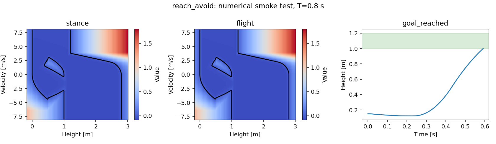

# Additional example: a vertical jumping robot

[Home](../README.md) · [Falling-piece tutorial](README.md) · [Concepts](../docs/OVERVIEW.md) · [Paper examples](../examples/papers/README.md)

In this tutorial you will compute where a small robot can jump, use the result
to control it, and inspect its trajectory. The robot moves only vertically, so
its value function fits in a two-dimensional plot. This is a teaching model;
the paper's planar jumper comes later.

You need the package installed with the `examples` extra. Follow the
[setup instructions](../docs/SETUP.md) first, then run all commands below from
the repository root.

## 1. Run the complete example

```bash
JAX_PLATFORMS=cpu JAX_ENABLE_X64=true python tutorials/jumper.py
```

The script solves three versions of the task and prints a status for each:

| Folder under `outputs/jumper/` | Task | Expected outcome in the recorded CPU run |
|---|---|---|
| `reach/` | Reach the 1.0–1.2 m height band | `goal_reached` |
| `avoid/` | Avoid the floor and 2.8 m ceiling for 0.8 s | `deadline`: the full interval completed |
| `reach_avoid/` | Reach the band while avoiding floor and ceiling | `goal_reached` |

Open `outputs/jumper/reach_avoid/values_and_rollout.png`. Each folder contains:

| File | What to use it for |
|---|---|
| `values_and_rollout.png` | Inspect the value fields and height trajectory |
| `summary.json` | Read the termination status, resets, backend and timings |
| `trajectory.npz` | Load sampled states, controls and intervention flags |
| `values.npy`, `axes.npz`, `metadata.json` | Reload the numerical reachability result |

The first invocation includes JAX compilation. The printed compilation and solve
times are separate. Reruns need a new output path because existing results are
protected:

```bash
JAX_PLATFORMS=cpu JAX_ENABLE_X64=true \
  python tutorials/jumper.py --output outputs/jumper_rerun
```

To run only one objective, add `--kind reach_avoid`.

## 2. Read the figure



This preview was generated with the tutorial's default grid and horizon on CPU.

The first two panels show `V(height, velocity, mode, T=0.8)` for stance and
flight. The black line, where present, is the zero contour. For reach and
reach-avoid, the nonpositive side is the computed winning region. For avoid,
the positive side is the computed safe region. Use the colorbar to identify
the sign; the interpretation changes with the objective.

The third panel shows the simulated height over time. The green band is the
height goal. A reach/reach-avoid trajectory stops on entering it. The avoid
trajectory continues until the horizon unless a failure occurs.

These panels answer different questions: the fields describe many possible
initial states; the trajectory shows feedback from one chosen initial state.
A successful trajectory alone does not establish accuracy of the entire field.

## 3. Define the hybrid system

The model lives in
[`vertical_jumper.py`](../src/hybrid_reach/examples/vertical_jumper.py).
Its state is `x=(z,vz)`, with height in metres and velocity in metres per second.

| Mode | Control | Continuous motion |
|---|---|---|
| `0`: stance | Upward force from 0 to 30 N | `dz/dt = vz`, `dvz/dt = force/mass - gravity` |
| `1`: flight | Zero force | `dz/dt = vz`, `dvz/dt = -gravity` |

The robot has mass 1 kg. At leg height 0.5 m, upward departure triggers flight;
downward arrival triggers stance. Both transitions are forced. Their reset maps
preserve position and velocity.

`make_system()` returns three objects: a `HybridModel` describing the modes and
transitions, a grid with 81 points on each continuous axis, and signed guard
events for forward simulation. Boolean guards tell the PDE which grid states
can switch; signed events locate the switching instant during integration.

To build your own dynamics, subclass `hj_reachability.Dynamics` and implement
`__call__`, `optimal_control_and_disturbance` and `partial_max_magnitudes`.
The last method supplies dissipation/CFL bounds over the admissible input space.
The optimizer must honor `self.control_mode` and `self.disturbance_mode`, which
the problem layer configures. Start by adapting the small model file above.
Declare each mode as a `Mode`, each guard/reset as a `Transition`, and group
simultaneous edges in a `ProjectionStage`. More involved reset composition and
sampling choices are described in the [API reference](../docs/API.md).

## 4. Choose a task and solve it

The following Python blocks form one walkthrough. Use an interactive Python
session or put them in a script and launch it with `JAX_ENABLE_X64=true`.

```python
import numpy as np
from hybrid_reach import (
    Problem, solve, Result, ContinuousFeedback, AvoidFilter, simulate,
)
from hybrid_reach.examples.vertical_jumper import make_system, goal, failure

model, grid, events = make_system()
problem = Problem.reach_avoid(model, grid, goal, failure)
horizons = np.linspace(0., .8, 81)
result = solve(problem, horizons, save_indices=tuple(range(0, 81, 5)))
print(result.values.shape)  # (17, 2, 81, 81)
```

Every adjacent pair of `horizons` is a hybrid coupling interval: here 0.01 s.
We save every fifth interval, or 0.05 s. All coupling intervals still execute.
The array axes are `(saved_horizon, mode, height, velocity)`.

Both input set functions are **negative inside** their sets. In the model,
`goal` returns `abs(z - 1.1) - .1`, and `failure` returns
`min(z, 2.8 - z)`. The latter is negative outside the floor/ceiling bounds.
The simulator also treats contact with their boundaries as failure.

To select another objective, use `Problem.reach(model, grid, goal)` or
`Problem.avoid(model, grid, failure)` and solve that new problem.
The problem layer selects the control optimization direction automatically.

## 5. Save, reload and control the robot

```python
result.save('outputs/tutorial_walkthrough/reach_avoid')
result = Result.load('outputs/tutorial_walkthrough/reach_avoid')
controller = ContinuousFeedback(problem, result)

trajectory = simulate(
    problem, controller, initial_state=[.15, 0.], initial_mode=0,
    duration=.8, feedback_dt=.005, events=events,
    failure=lambda x, q: float(failure(x, q)),
    goal=lambda x, q: float(goal(x, q)),
)
print(trajectory['status'])
print(trajectory['final_state'])
```

`ContinuousFeedback` uses the value gradient to choose the goal-seeking force.
The simulator starts at height 0.15 m, at rest in stance. It queries feedback
every 0.005 s and also stops integration at switching events. After each reset,
it queries the controller in the resulting mode. Remaining time decreases from
0.8 s as physical time advances.

`Result.load` reads the values as a memory map. The numerical files do not store
Python dynamics; retain the model code and parameters so you can reconstruct
`problem` when loading in a new process.

## 6. Try the avoid safety filter

Now give the robot a nominal zero-force control. The avoid filter passes it
through when the candidate's value is above the margin and intervenes otherwise.
This block reuses `model`, `grid` and `events` from the walkthrough:

```python
avoid_problem = Problem.avoid(model, grid, failure)
avoid_result = solve(avoid_problem, horizons,
                     save_indices=tuple(range(0, 81, 5)))
hlrf = AvoidFilter(avoid_problem, avoid_result, margin=.03)

def filtered_control(state, mode, time_to_go):
    return hlrf(state, mode, time_to_go,
                nominal_control=lambda post_state, post_mode: np.zeros(1))

avoid_trajectory = simulate(
    avoid_problem, filtered_control, [.15, 0.], 0,
    duration=.8, feedback_dt=.005, events=events,
    failure=lambda x, q: float(failure(x, q)),
)
print(avoid_trajectory['status'])  # deadline: completed the finite horizon
print(avoid_trajectory['continuous_intervention'].sum())
```

The nominal callback receives the post-reset state and mode. Its returned input
must be admissible there. This jumper has only forced switches; models with
controlled transitions can also request nominal discrete choices. See
[`AvoidFilter` in the API reference](../docs/API.md) for those arguments.

If every candidate is unsafe, the filter still chooses its best legal action
and reports `safe_candidate=False`. Its margin is an intervention buffer.
Reach/reach-avoid use goal-seeking feedback; the package's least-restrictive
filter is available for avoid only.

## 7. Make one change

First change the height goal while keeping the dynamics and grid fixed:

```python
def higher_goal(states, mode):
    return abs(states[..., 0] - 1.4) - .1

higher_problem = Problem.reach_avoid(model, grid, higher_goal, failure)
higher_result = solve(higher_problem, horizons)
```

Use `higher_problem` and `higher_result` together for its controller. Then try
changing the grid through `make_system(shape=(101,101))`, the horizon, or the
feedback interval, one at a time. These affect different approximations; see
[the overview's resolution table](../docs/OVERVIEW.md#what-changes-when-you-refine-a-result).

Continue with the [planar jumper](PLANAR_JUMPER.md) for horizontal motion and
pillars, or the [paper guide](../examples/papers/README.md) for complete experiment
commands and recorded outcomes.
